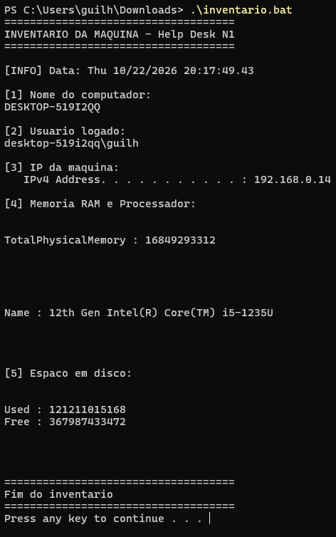

# Guilherme Medeiros | Help Desk N1 | Suporte Jr | Carapicuíba-SP

📍 Osasco/SP - Disponível para Presencial, Híbrido e Remoto
🔎 Em busca de primeira oportunidade como **Help Desk N1, Analista de Suporte Jr, Estágio em TI**

### 🛠️ O que eu já resolvo no meu lab

#### Scripts que criei e uso:
| Script | O que faz | Comando principal |
| :--- | :--- | :--- |
| `inventario.bat` | Coleta dados do PC para inventário | `ipconfig`, `wmic`, `hostname` |
| `limpeza.ps1` | Limpeza e otimização rápida | `Remove-Item Temp`, `ipconfig /flushdns` |
| `diagnostico-rede.bat` | Diagnóstico completo de internet | `ping`, `nslookup`, `ipconfig` |

#### Chamados que simulo:
- **"Sem internet"** -> Verifico IP > ping gateway > ping 8.8.8.8 > teste DNS > flushdns
- **"PC muito lento"** -> Verifico espaço em disco > limpo %temp% > desativo inicialização > msconfig
- **"Impressora offline"** -> Reinicio spooler > removo e adiciono porta > teste de impressão
- **"Office não abre"** -> Reparo rápido pelo painel + limpeza de cache

### 🧰 Ferramentas e Conhecimentos
- **Sistemas:** Windows 10/11, formatação, instalação de drivers
- **Redes:** IP, DHCP, DNS, Ping, Tracert, VPN básica
- **Suporte:** Active Directory (criar/resetar usuário), Office 365, GLPI/ chamados
- **Conceitos:** ITIL básico, documentação de chamados

### 📸 Meu lab rodando

## O que esse script coleta
- Hostname, usuário, IP
- Memória, processador, disco
- Compatível com Windows 10 e 11

### 🚀 Como executar
1. Baixe a pasta `scripts`
2. Clique direito > Executar como administrador
3. Veja o log gerado

### 📞 Contato
- **GitHub:** @guilherme-medeiros-oliveira
- **LinkedIn:** [https://www.linkedin.com/in/guilherme-medeiros-oliveira-478b45291]
- **WhatsApp:** [+55 11 924769540]

---
*Repositório criado para comprovar prática em Help Desk N1. Em constante atualização com novos scripts.*
